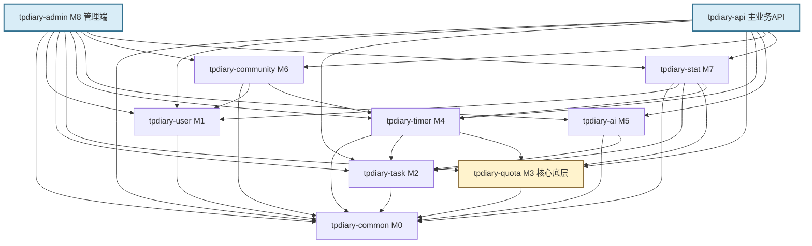

# TPDiary 一期模块划分与依赖治理

**阶段**：P03 · 模块划分与依赖治理  
**版本**：v1.0  
**状态**：一期工程结构基线  
**前置基线**：`P01-需求边界与验收基线.md`、`P02-技术选型评审与ADR.md`

## 一、结构结论

1. 采用一个 Maven 聚合工程、九个 M0～M8 业务模块和一个启动模块。
2. 所有模块最终组装为一个 Spring Boot 应用，不形成独立服务。
3. `tpdiary-common` 只承载无业务归属的共享契约；`tpdiary-quota` 是最底层业务模块，只依赖 `tpdiary-common`。
4. 依赖只能从上层指向下层。`quota` 不依赖任何其他业务模块，也不发布到统计表的数据库写入。
5. 跨模块同步操作调用下层的 application 接口；只为提交后的统计投影、提醒等非核心闭环使用 Spring 事件。
6. quota 在自身事务内维护额度发放计数和账本；stat 维护面向看板的日/周投影，不参与额度发放判定。

## 二、模块职责

| 模块 | 对应 | 职责 | 禁止事项 |
|---|---|---|---|
| `tpdiary-common` | M0 | 通用返回、异常码、分页、时钟、用户上下文、跨模块事件契约和基础安全契约 | 不承载任何具体业务规则，不依赖 M1～M8 |
| `tpdiary-user` | M1 | 注册登录、游客令牌、个人资料、身份方向 | 不管理额度、任务和社区内容 |
| `tpdiary-task` | M2 | 短任务、长任务、任务节点和任务状态 | 不直接写额度批次或额度流水 |
| `tpdiary-quota` | M3 | 额度发放、日/周上限、批次、消费、过期和流水 | 不依赖任何业务模块；不直接写 stat 表 |
| `tpdiary-timer` | M4 | 专注和躺平会话状态机、有效时长、心跳和恢复 | 不直接访问 quota 的 Mapper 或数据表 |
| `tpdiary-ai` | M5 | AI 规划、在岗事件和智能提醒调度 | 不成为任务和计时的强依赖 |
| `tpdiary-community` | M6 | 发帖、图片、点赞、评论和敏感词过滤 | 不自行重算专注时长或额度 |
| `tpdiary-stat` | M7 | 日/周/月统计投影、首页看板、日历和图表查询 | 不参与额度发放的硬上限判定 |
| `tpdiary-admin` | M8 + 管理端启动层 | 敏感词、内容审核、用户与额度排查；提供独立管理端启动入口 | 不绕过领域服务直接改业务数据 |
| `tpdiary-api` | 主业务 API 启动层 | 客户端 API 的 `main`、组件扫描、Web/Security/数据库/Redis 配置和跨模块装配 | 不承载业务规则，不被任何业务模块依赖 |

## 三、完整目录树

下面的 `pom.xml` 注释标出每个模块的直接内部依赖；第三方依赖由父 POM 统一管理版本，各模块按实际使用显式声明。

```text
TPDiary/
├── pom.xml                                      # 父 POM：packaging=pom，聚合全部模块
├── .mvn/
│   └── wrapper/
├── mvnw
├── mvnw.cmd
├── docker-compose.yml
├── 企划书.txt
├── 开发流程.docx
├── P01-需求边界与验收基线.md
├── P02-技术选型评审与ADR.md
├── P03-模块划分与依赖治理.md
├── tpdiary-common/
│   ├── pom.xml                                  # M0 -> 无内部模块依赖
│   └── src/
│       ├── main/java/com/tpdiary/common/
│       │   ├── api/                             # ApiResponse、PageResponse、错误码
│       │   ├── event/                           # FocusSettledEvent、QuotaGrantedEvent 等
│       │   ├── exception/                       # 统一业务异常
│       │   ├── security/                        # 当前用户、认证上下文契约
│       │   ├── time/                            # Clock 抽象和服务端时间工具
│       │   └── util/                            # 无业务含义的通用工具
│       └── test/java/com/tpdiary/common/
├── tpdiary-user/
│   ├── pom.xml                                  # M1 -> common
│   └── src/
│       ├── main/java/com/tpdiary/user/
│       │   ├── controller/                      # AuthController、ProfileController
│       │   ├── application/                     # 登录、游客、资料应用服务与跨模块接口
│       │   ├── domain/
│       │   │   ├── model/                       # User、IdentityType
│       │   │   ├── service/                     # 密码策略、用户领域规则
│       │   │   └── port/                        # UserRepository 等端口
│       │   └── infrastructure/
│       │       ├── persistence/                 # UserMapper、Repository 实现
│       │       └── security/                    # UserDetails 适配
│       └── test/java/com/tpdiary/user/
├── tpdiary-task/
│   ├── pom.xml                                  # M2 -> common
│   └── src/
│       ├── main/java/com/tpdiary/task/
│       │   ├── controller/                      # TaskController
│       │   ├── application/                     # 任务 CRUD、节点、长期目标应用服务
│       │   ├── domain/
│       │   │   ├── model/                       # Task、TaskNode、TaskStatus
│       │   │   ├── service/                     # 节点数量和领取状态规则
│       │   │   └── port/                        # TaskRepository、NodeRepository
│       │   └── infrastructure/persistence/
│       └── test/java/com/tpdiary/task/
├── tpdiary-quota/
│   ├── pom.xml                                  # M3 -> common（仅此一个内部依赖）
│   └── src/
│       ├── main/java/com/tpdiary/quota/
│       │   ├── controller/                      # QuotaController
│       │   ├── application/                     # 发放、余额、扣减、流水应用接口
│       │   ├── domain/
│       │   │   ├── model/                       # QuotaBatch、QuotaLedger、SourceType
│       │   │   ├── service/                     # 4:1、上限、FIFO、7 天过期规则
│       │   │   └── port/                        # BatchRepo、LedgerRepo、LockPort
│       │   └── infrastructure/
│       │       ├── persistence/                 # 批次和流水 Mapper
│       │       └── cache/                       # Redis 缓存与锁适配
│       └── test/java/com/tpdiary/quota/
├── tpdiary-timer/
│   ├── pom.xml                                  # M4 -> common、task、quota
│   └── src/
│       ├── main/java/com/tpdiary/timer/
│       │   ├── controller/                      # FocusController、RestController
│       │   ├── application/                     # 计时状态机、结算编排、查询接口
│       │   ├── domain/
│       │   │   ├── model/                       # FocusSession、RestSession
│       │   │   ├── service/                     # 有效时长和状态转换
│       │   │   └── port/                        # SessionRepository、QuotaPort、TaskQueryPort
│       │   └── infrastructure/
│       │       ├── persistence/
│       │       └── quota/                       # 对 quota application 接口的适配
│       └── test/java/com/tpdiary/timer/
├── tpdiary-ai/
│   ├── pom.xml                                  # M5 -> common、task
│   └── src/
│       ├── main/java/com/tpdiary/ai/
│       │   ├── controller/                      # AiPlanController、ProctorController
│       │   ├── application/                     # 规划、在岗事件、提醒调度
│       │   ├── domain/
│       │   │   ├── model/                       # AiPlan、ProctorEvent
│       │   │   ├── service/                     # 规划降级、提醒判定
│       │   │   └── port/                        # AiClientPort、PlanRepository
│       │   └── infrastructure/
│       │       ├── persistence/
│       │       └── client/                      # LangChain4j/大模型适配
│       └── test/java/com/tpdiary/ai/
├── tpdiary-community/
│   ├── pom.xml                                  # M6 -> common、user、timer
│   └── src/
│       ├── main/java/com/tpdiary/community/
│       │   ├── controller/                      # PostController、CommentController
│       │   ├── application/                     # 发帖资格、内容、互动应用服务
│       │   ├── domain/
│       │   │   ├── model/                       # Post、Comment、Like
│       │   │   ├── service/                     # 内容状态和互动规则
│       │   │   └── port/                        # PostRepo、FocusEligibilityQuery
│       │   └── infrastructure/
│       │       ├── persistence/
│       │       ├── storage/                     # 图片存储适配
│       │       └── filter/                      # 基础敏感词过滤
│       └── test/java/com/tpdiary/community/
├── tpdiary-stat/
│   ├── pom.xml                                  # M7 -> common、user、task、quota、timer
│   └── src/
│       ├── main/java/com/tpdiary/stat/
│       │   ├── controller/                      # DashboardController
│       │   ├── application/                     # 看板、日历、图表查询和投影服务
│       │   ├── domain/
│       │   │   ├── model/                       # DailyStat、PeriodStat
│       │   │   ├── service/                     # 统计口径和聚合
│       │   │   └── port/                        # StatRepository、各域查询端口
│       │   └── infrastructure/
│       │       ├── persistence/
│       │       └── event/                       # AFTER_COMMIT 事件监听器
│       └── test/java/com/tpdiary/stat/
├── tpdiary-admin/
│   ├── pom.xml                                  # M8 -> common 和 M1～M7
│   └── src/
│       ├── main/java/com/tpdiary/admin/
│       │   ├── TPDiaryAdminApplication.java     # 管理端独立启动入口
│       │   ├── config/                          # 管理端配置
│       │   ├── controller/                      # 敏感词、审核、排查接口
│       │   ├── application/                     # 管理端用例编排
│       │   └── infrastructure/                  # 管理端权限适配
│       ├── main/resources/application.yml
│       └── test/java/com/tpdiary/admin/
└── tpdiary-api/
    ├── pom.xml                                  # 主 API -> common 和 M1～M7
    └── src/
        ├── main/java/com/tpdiary/api/
        │   ├── TPDiaryApiApplication.java        # 客户端 API 独立启动入口
        │   └── config/                          # Security、Web、MyBatis、Redis、Jackson
        ├── main/resources/
        │   ├── application.yml
        │   └── db/migration/                    # 主业务 API 持有 Flyway 迁移
        └── test/java/com/tpdiary/api/           # 集成测试和架构测试
```

## 四、模块 POM 依赖矩阵

| 模块 | 直接依赖的内部模块 | 不得依赖 |
|---|---|---|
| `tpdiary-common` | 无 | M1～M8、admin、api |
| `tpdiary-user` | common | task、quota、timer、ai、community、stat、admin、api |
| `tpdiary-task` | common | user、quota、timer、ai、community、stat、admin、api |
| `tpdiary-quota` | common | M1、M2、M4～M8、admin、api |
| `tpdiary-timer` | common、task、quota | ai、community、stat、admin、api |
| `tpdiary-ai` | common、task | user、quota、timer、community、stat、admin、api |
| `tpdiary-community` | common、user、timer | task、quota、ai、stat、admin、api |
| `tpdiary-stat` | common、user、task、quota、timer | ai、community、admin、api |
| `tpdiary-admin` | common、M1～M7 | api |
| `tpdiary-api` | common、M1～M7 | admin；任何业务模块不得反向引用 |

父 POM 只负责聚合、统一 Java 版本、依赖版本和构建插件，不通过 `<dependencies>` 把所有库强加给子模块。`tpdiary-api` 负责主业务数据库迁移，避免多个模块争抢迁移顺序；`tpdiary-admin` 从同一数据库读取管理数据。

## 五、模块依赖图



依赖图是有向无环图。`quota` 只指向 `common`，没有任何路径从 `quota` 返回 `task`、`timer`、`stat` 或其他业务模块。

## 六、分层规范

### 6.1 controller

- 只处理 HTTP 协议：鉴权入口、参数绑定、Bean Validation、响应码和 DTO 转换。
- 只调用本模块 application 接口，不调用 Mapper、Repository、Redis、其他模块 infrastructure。
- 不写 `@Transactional`，不在控制器中出现额度上限、兑换比例、状态迁移等业务判断。
- 对外 DTO 不得直接暴露持久化实体和领域聚合。

### 6.2 application

- 表示用例边界，负责事务、幂等键、权限范围校验、跨模块编排和提交后事件。
- 调用本模块 domain 规则以及下层模块的 application 接口。
- 每个公开用例有一个明确的 command/query，跨模块接口只放在 application 层。
- `@Transactional` 放在 application 方法上；事件监听器需幂等，异常不得回滚已经提交的核心业务。

### 6.3 domain

- 放聚合、值对象、状态机、业务政策和端口接口，不依赖 MyBatis、HTTP、Redis 客户端。
- quota 的 4:1 换算、10800/86400 秒上限、7 天有效期、FIFO 扣减和幂等约束必须集中在这里。
- task 的 0～5 个节点、节点一次性领取规则集中在这里。
- timer 的有效时长和会话状态迁移集中在这里。
- 领域对象不得引用其他模块的领域对象；只使用 ID、值对象或 common 中的事件契约。

### 6.4 infrastructure

- 实现 domain port，包括 MyBatis Mapper、Redis、对象存储、外部模型 API 和消息适配。
- 不包含领域决策；不得把 SQL 中的随手条件当成业务规则来源。
- 外部 AI、摄像头事件、文件存储都通过端口隔离，适配器失败由 application 或 domain 策略降级。

### 6.5 common 与启动模块

- `common` 只放跨模块稳定契约和通用技术代码，不放任何模块的数据表语义。
- `tpdiary-api` 与 `tpdiary-admin` 只负责各自组件扫描、配置、装配和启动，不反向被业务模块引用。
- Spring Security 配置在启动模块；用户身份查询由 user 模块通过接口提供。

## 七、跨模块调用规则

| 场景 | 机制 | 事务与一致性 | 原因 |
|---|---|---|---|
| timer 结算专注会话 | 调用 quota application 接口 | 同步；用户请求成功前完成额度发放和幂等校验 | 额度必须与结算结果绑定，不能用事件延迟 |
| task 领取节点奖励 | 调用 quota application 接口 | 同步；节点状态与额度发放保持一致 | 防止节点已领取但额度丢失 |
| timer 开启/扣减躺平 | 调用 quota application 接口 | 同步；先校验余额，再开始或扣减 | 余额不足必须立即阻断 |
| community 校验发帖资格 | 调用 timer 的 application 查询接口 | 同步只读 | 发帖时必须有确定结果，不能等待统计投影 |
| quota 发放、消费、过期 | 发布 common 中定义的领域事件 | `AFTER_COMMIT` 投递；统计消费者幂等 | 统计和提醒不能阻塞或回滚额度事务 |
| focus settled / task completed | 发布 common 中定义的领域事件 | `AFTER_COMMIT` | stat 更新打卡、日历和聚合看板 |
| AI 为任务生成拆解 | 调用 task 的 application 接口 | 同步；AI 模块依赖 task | task 不依赖 AI，避免反向依赖 |
| admin 排查和审核 | 调用各域 application 查询/管理接口 | 同步 | 管理动作必须复用标准业务校验，不直连 Mapper |
| 提醒触发 | `t_reminder` + 定时扫描 | 异步；唯一业务键去重 | AI 或服务重启后仍可恢复 |

### 7.1 Spring 事件使用约束

- 只用于提交后的统计投影、提醒和非关键副作用。
- 事件定义放在 `common/event`，只包含 ID、时间和必要的原始字段，不引用模块实体。
- 首期默认同步执行 `@TransactionalEventListener(phase = AFTER_COMMIT)`，处理器必须幂等且短小；不默认开启 `@Async`。
- 事件处理失败不得删除或回滚核心账本；记录失败状态，由定时任务补偿或对账修复。
- 额度发放、扣减、发帖资格和鉴权不允许用事件替代同步结果。

### 7.2 领域服务接口使用约束

- 所有跨模块同步调用只依赖对方 application 层接口，不依赖对方的 domain、Mapper 或 Entity。
- 接口参数使用 ID、命令对象或查询对象；禁止传入对方的持久化对象。
- quota 对外只暴露“按来源和有效时长发放”“查余额”“消费”等有业务语义的接口，不暴露任意增减余额的方法。
- 模块没有明确业务需要时，不新增依赖；admin 和 stat 是唯一允许汇总调用多个模块的模块。

## 八、三个反例与正确改法

### 8.1 Controller 直连 Mapper

**错误调用链**

```text
FocusController
  -> FocusSessionMapper.selectList(...)
```

这会把 HTTP 输入、业务规则和数据库结构绑在一起，并在模块内绕过 application 事务。

**正确调用链**

```text
FocusController
  -> FocusApplicationService.listCurrent(...)
  -> FocusSessionRepositoryPort
  -> MyBatisFocusSessionRepository
  -> FocusSessionMapper
```

Controller 只负责参数校验和响应映射；查询权限、断线恢复和领域状态均进入 application。

### 8.2 timer 直接操作 quota 表或 quota 反向依赖 timer

**错误调用链**

```text
TimerApplicationService
  -> QuotaBatchMapper.updateRemainSeconds(...)

QuotaExpiryService
  -> TimerSessionService.updateSessionStatus(...)
```

前者绕过额度规则和事务，后者让底层 quota 依赖上层 timer，形成业务反向依赖。

**正确调用链**

```text
TimerApplicationService
  -> QuotaApplicationService.settleFocus(sessionId, effectiveSeconds)

QuotaExpiryService
  -> ApplicationEventPublisher.publishEvent(QuotaExpiredEvent)
  -> stat / reminder listener（AFTER_COMMIT）
```

quota 只处理和发布自己的事实，timer 和 stat 作为上层消费者响应。

### 8.3 quota 为更新看板而依赖 stat，或直接改 `t_daily_stat`

**错误调用链**

```text
QuotaGrantService
  -> StatDailyMapper.incrementEarnedSeconds(...)
```

这会使核心账本依赖统计模块，并让统计数据参与或干扰额度事务。

**正确调用链**

```text
QuotaGrantService
  -> 在 quota 事务内写批次、流水和 quota 发放计数
  -> AFTER_COMMIT 发布 QuotaGrantedEvent
  -> StatProjectionListener 幂等更新 DailyStat
```

额度上限由 quota 自有的事务计数和流水判定；stat 只生成展示投影。对账任务校验 quota 计数、批次余额和流水净额，stat 异常不会扩大或吞噬用户额度。

## 九、构建与依赖治理

1. 父 POM 使用 `dependencyManagement` 锁定版本，子模块只声明实际直接依赖。
2. 主业务模块不依赖 `tpdiary-api` 或 `tpdiary-admin` 启动包，不把业务 Controller 放入启动模块。
3. 跨模块 import 只允许 `application` 公共接口、`common` 契约和已声明的下层模块。
4. quota 的 POM 只包含 common，代码评审必须检查 `com.tpdiary.quota` 是否出现上层模块 import。
5. 事件处理器的幂等测试与模块依赖测试放入 `tpdiary-api` 集成测试；管理端启动测试放在 `tpdiary-admin`。
6. CI 每次合并执行以下检查：

```bash
mvn -B -q validate dependency:tree -Dincludes=com.tpdiary:*
mvn -B -q test
```

7. Maven reactor 在发现模块循环时会直接构建失败；CI 还必须保留完整的 `dependency:tree` 输出用于评审。
8. 如果发现共享模型导致依赖激增，优先在 common 中增加稳定事件或值对象契约，不通过互相依赖模块实体解决。

## 十、结构验收

| 验收项 | 通过标准 | 负责人 |
|---|---|---|
| Maven 聚合结构 | 根 POM 聚合 common、M1～M8、admin 和 api；`mvn validate` 成功 | 后端负责人 |
| 无循环依赖 | `mvn dependency:tree` 无 cycle，依赖图与本文一致 | 后端负责人；测试 |
| quota 底层约束 | quota POM 只依赖 common；源码无 M1、M2、M4～M8 的 import | 后端负责人 |
| Controller 分层 | Controller 无 Mapper 注入、无领域规则、无跨模块 Mapper 调用 | 代码评审 |
| application 事务 | 结算、扣减和节点奖励在 application 事务边界内完成 | 后端负责人 |
| 事件幂等 | 重复投递 `FocusSettledEvent`、`QuotaGrantedEvent` 不产生重复统计或额度 | 后端负责人；测试 |
| 发帖资格实时性 | community 通过 timer application 查询，不等待 stat 聚合 | 后端负责人；测试 |
| 依赖治理 | CI 同时执行 `dependency:tree`、测试和 quota import 检查 | 后端负责人 |
