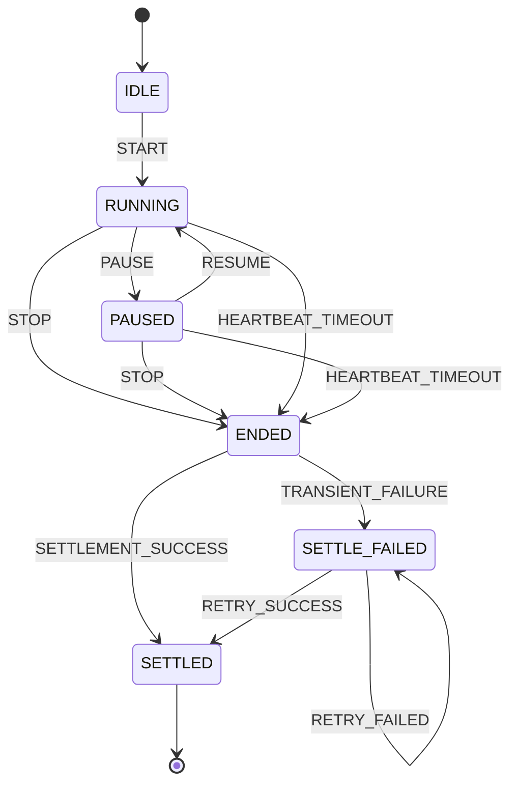
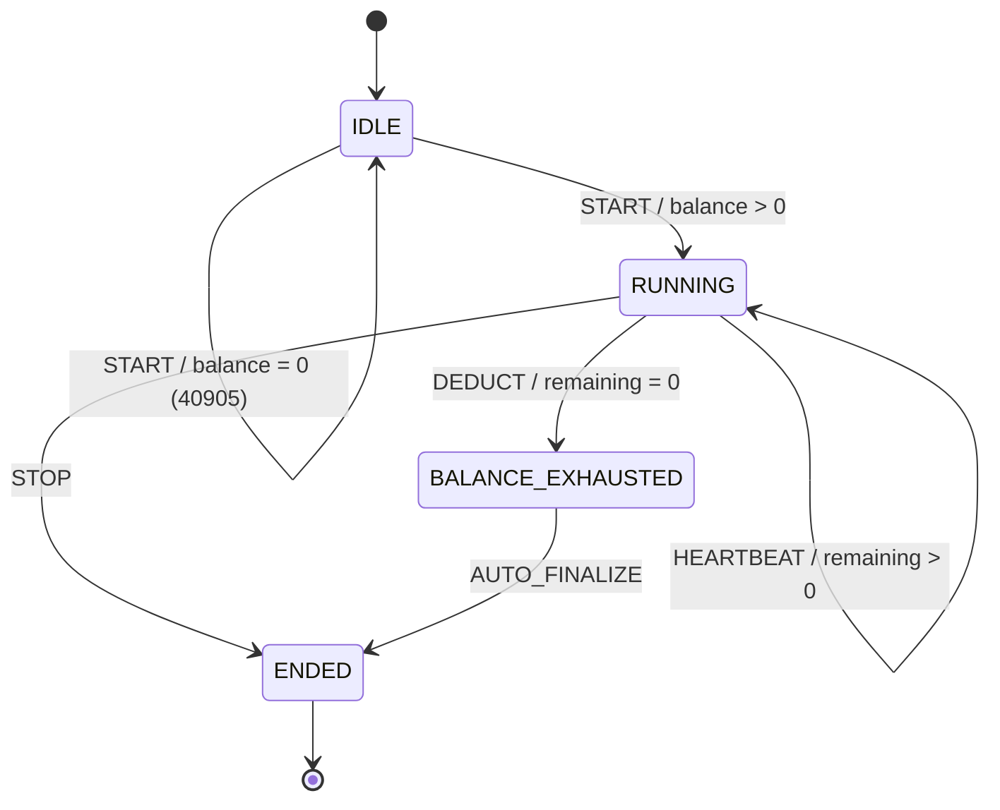
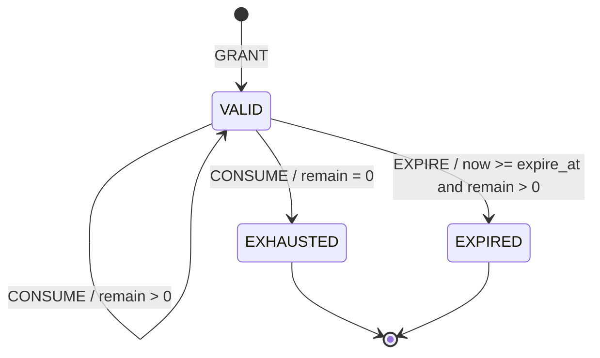
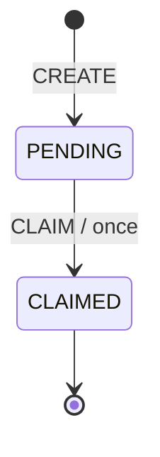

# TPDiary 核心业务规则领域模型与状态机

**阶段**：P07 · 核心业务规则建模  
**版本**：v1.0  
**优先级**：最高  
**关联基线**：P01 需求边界、P03 模块依赖、P04 数据库、P05 Redis、P06 接口契约

## 一、建模结论

1. 规则 1、2、3、4、5 的额度计算部分和规则 6 的额度来源约束唯一实现于 `tpdiary-quota` 的 `QuotaDomainService`。
2. Controller 只做协议适配，application 只编排事务和幂等，scheduler 只触发 application 用例；三者不得重新计算比例、上限、有效期或余额。
3. 专注会话的应用状态为 `IDLE/RUNNING/PAUSED/ENDED/SETTLED/SETTLE_FAILED`；数据库用会话状态与结算状态两个维度持久化。
4. 躺平会话的 `BALANCE_EXHAUSTED` 是领域内瞬时状态，随后在同一事务中完成 `ENDED`；数据库最终保存 `ENDED` 和结束原因。
5. 实际可得为 0 是正常结算结果，不生成批次，也不能让会话停留在失败状态。
6. 所有时间边界使用服务端业务时区 `Asia/Shanghai` 和已持久化的业务时间。

## 二、领域对象

| 领域对象 | 所属模块 | 核心职责 | 维护的不变量 |
|---|---|---|---|
| `FocusSession` | M4 `tpdiary-timer` | 专注生命周期、暂停、恢复、有效时长、结束 | 同一用户最多一个活动会话；结束后不可恢复；重复结算返回原结果 |
| `RestSession` | M4 `tpdiary-timer` | 躺平生命周期、心跳、余额耗尽和结束原因 | 余额为 0 不得开始；消费不能为负；余额耗尽必须结束 |
| `QuotaBatch` | M3 `tpdiary-quota` | 单笔额度金额、剩余额度和有效期 | `0 <= remain <= amount`；终态不可恢复；到期后不可消费 |
| `QuotaLedger` | M3 `tpdiary-quota` | 收入、支出、过期流水 | 追加写；金额始终为正；幂等键唯一 |
| `QuotaGrantCounter` | M3 `tpdiary-quota` | 日/周事务内发放累计 | 日累计不超过 10800 秒；周累计不超过 86400 秒 |
| `TaskNode` | M2 `tpdiary-task` | 节点配置和领取状态 | `seq` 唯一；状态只能领取一次；节点数量和奖励值调用 `QuotaDomainService` 校验 |
| `PostingEligibility` | M3 计算 / M7 展示 | 当日累计有效专注达到 1800 秒 | 阈值只由 `QuotaDomainService.isPostUnlocked` 判定 |

### 2.1 应用状态与数据库映射

| 领域状态 | 数据库字段 | API 表现 |
|---|---|---|
| 专注 `RUNNING` | `t_focus_session.status=1` | `status=RUNNING` |
| 专注 `PAUSED` | `t_focus_session.status=2` | `status=PAUSED` |
| 专注 `ENDED` | `status=3` 或异常结束 `status=4` | `status=ENDED`，异常映射为 `endReason=ABNORMAL` |
| 专注 `SETTLED` | `settlement_status=1, settled=1` | `settlementStatus=SETTLED` |
| 专注 `SETTLE_FAILED` | `settlement_status=2, settled=0` | `settlementStatus=FAILED` |
| 躺平 `RUNNING` | `t_rest_session.status=1` | `status=RUNNING` |
| 躺平 `BALANCE_EXHAUSTED` | 不单独落库，事务内瞬时状态 | 最终返回 `status=ENDED, endReason=BALANCE_EXHAUSTED` |
| 躺平 `ENDED` | `status=2` | `status=ENDED` |
| 额度 `VALID` | `t_quota_batch.status=1` | `status=VALID` |
| 额度 `EXHAUSTED` | `status=2` | `status=EXHAUSTED` |
| 额度 `EXPIRED` | `status=3` | `status=EXPIRED` |
| 节点 `PENDING` | `t_task_node.status=0` | `status=PENDING` |
| 节点 `CLAIMED` | `status=1` | `status=CLAIMED` |

## 三、四个状态机

### 3.1 专注会话



- `IDLE` 表示用户当前没有专注会话，不生成 `t_focus_session` 行。
- 首次 `START` 创建会话并进入 `RUNNING`。
- 开始时 `end_time` 必须为空；结束后不可再次暂停或恢复。
- 服务端首次接受 `STOP` 时记录 `end_time`；数据库提交时间不改变业务日归属。
- 实际额度为 0 仍进入 `SETTLED`，`earnedSeconds=0`。
- 只有数据库、锁或内部约束导致的暂态失败才进入 `SETTLE_FAILED`。
- `SETTLE_FAILED` 只能通过结算补偿重试，不能恢复计时。

### 3.2 躺平会话



- `BALANCE_EXHAUSTED` 不单独持久化；进入该状态后必须立即结束会话，`end_reason=2`。
- 用户在余额仍大于 0 时主动停止，进入 `ENDED`，`end_reason=1`。
- 正常结束后的重复停止属于幂等重放，不重新打开会话。
- 开始前余额为 0 不创建会话，返回 `40905`。

### 3.3 额度批次



- `amount_seconds > 0`；余额为 0 时不创建批次。
- 到期前 1 毫秒仍有效；服务端时间达到或超过 `expire_at` 时立即不可消费。
- 剩余额度为 0 的批次进入 `EXHAUSTED`，不写过期流水。
- 仍有余额的批次到期时进入 `EXPIRED`，剩余额度清零并写一条过期流水。
- `EXHAUSTED` 与 `EXPIRED` 都是终态，不允许恢复或返还。

### 3.4 任务节点



- 一个任务最多配置 5 个节点，`seq` 唯一。
- 节点奖励可配置为 0；奖励为 0 时仍可从未领取变为 `CLAIMED`，但不生成额度批次。
- 节点进入 `CLAIMED` 与额度发放必须处于同一数据库事务；任一步失败则一起回滚。
- 重复领取不产生状态跃迁，返回第一次成功结果和 `replayed=true`。
- 节点配置的 CANCELLED 状态属于任务编辑流程，不属于奖励领取状态机；已领取节点不可取消。

## 四、规则唯一实现边界

### 4.1 QuotaDomainService

`tpdiary-quota/domain/service/QuotaDomainService` 是以下规则的唯一实现：

| 规则 | 领域常量/方法 | 其他层责任 |
|---|---|---|
| 1. 专注 4:1 | `FOCUS_SECONDS_PER_QUOTA_SECOND=4`；`focusGrantSeconds(effectiveSeconds)` | timer 只提供有效专注秒数 |
| 2. 日/周上限 | `DAY_CAP_SECONDS=10800`、`WEEK_CAP_SECONDS=86400`；`calculateActualGrant(...)` | application 负责锁和事务 |
| 3. 7 天过期 | `QUOTA_TTL_DAYS=7`；`expireAt(grantTime)`、`expire(batch, now)` | scheduler 只触发生效用例 |
| 4. 30 分钟发帖资格 | `POST_UNLOCK_SECONDS=1800`；`isPostUnlocked(dailyEffectiveSeconds)` | community 只读取资格结果 |
| 5. 节点奖励额度 | `validateNodeDefinition(nodeCount, seq, rewardSeconds)`、`grantNodeReward(...)` | task 负责节点持久化与状态 |
| 6. 额度来源 | `assertGrantSource(sourceType)`，只接受 FOCUS 和 NODE_REWARD | application 不提供充值、购买或转让命令 |

### 4.2 调用方向

```text
Controller
  -> Application service
  -> QuotaDomainService（唯一公式和上限实现）
  -> Domain ports
  -> Infrastructure adapters
```

- `tpdiary-timer` 的结束会话用例调用 quota application 接口；不读取额度公式。
- `tpdiary-task` 的节点领取用例调用 quota grant 用例；不自行截断日/周上限。
- scheduler 调用 `ExpireQuotaApplicationService` 和 `RetrySettlementApplicationService`，不直接写配额表。
- Controller 不出现 `43200`、`10800`、`86400`、`expireAt + 7 days` 等表达式。
- 代码评审和架构测试禁止上述常量出现在 quota 域之外的业务模块。
- `t_daily_stat` 和 Redis 计数只做投影/加速，不参与最终发放结果。

## 五、额度结算伪代码

### 5.1 专注结算

```text
SETTLE_FOCUS(sessionId, idempotencyKey):
    businessTime = persistedFocusSession.end_time
    IF businessTime IS NULL:
        THROW FOCUS_SESSION_STATE_CONFLICT(40902)

    effectiveSeconds = persisted effective focus seconds
    theoreticalSeconds = FLOOR(effectiveSeconds / 4)   // 规则 1

    RETURN GRANT_QUOTA(
        user,
        sourceType = FOCUS_SETTLE,
        sourceId = sessionId,
        requestedSeconds = theoreticalSeconds,
        businessTime,
        idempotencyKey
    )
```

### 5.2 统一发放与规则 2 叠加

```text
GRANT_QUOTA(command):
    ASSERT sourceType IN [FOCUS_SETTLE, NODE_REWARD]   // 规则 6
    ASSERT requestedSeconds >= 0

    BEGIN TRANSACTION

    existing = findLedgerBy(user, command.idempotencyKey)
    IF existing EXISTS:
        RETURN existingGrantResult(replayed=true)

    dayStart = businessDate(command.businessTime)
    weekStart = MondayOf(command.businessTime)

    dayCounter = lockOrCreateCounter(user, DAY, dayStart)
    weekCounter = lockOrCreateCounter(user, WEEK, weekStart)

    dayRemaining = MAX(0, 10800 - dayCounter.grantedSeconds)
    weekRemaining = MAX(0, 86400 - weekCounter.grantedSeconds)

    actualSeconds = MIN(
        requestedSeconds,
        dayRemaining,
        weekRemaining
    )

    reason = classifyGrant(requestedSeconds, actualSeconds, dayRemaining, weekRemaining)

    IF actualSeconds <= 0:
        COMMIT WITHOUT creating batch or INCOME ledger
        RETURN {
            grantedSeconds: 0,
            reason,
            dayRemaining,
            weekRemaining,
            replayed: false
        }

    batch = INSERT QuotaBatch(
        user,
        amountSeconds = actualSeconds,
        remainSeconds = actualSeconds,
        sourceType = command.sourceType,
        sourceId = command.sourceId,
        grantTime = command.businessTime,
        grantDate = businessDate(command.businessTime),
        expireAt = command.businessTime + 7 days,       // 规则 3
        status = VALID
    )

    INSERT QuotaLedger(
        batchId = batch.id,
        direction = INCOME,
        amountSeconds = actualSeconds,
        idempotencyKey = command.idempotencyKey
    )

    dayCounter.grantedSeconds  += actualSeconds
    weekCounter.grantedSeconds += actualSeconds

    COMMIT

    PUBLISH AFTER_COMMIT QuotaGrantedEvent
    RETURN {
        grantedSeconds: actualSeconds,
        reason,
        dayRemaining: dayRemaining - actualSeconds,
        weekRemaining: weekRemaining - actualSeconds,
        batchId,
        replayed: false
    }
```

### 5.3 发放提示

| 条件 | `grantReason` | 业务结果 |
|---|---|---|
| `requestedSeconds=0` | `NO_EFFECTIVE_QUOTA` | 成功，不建批次，提示“本次有效专注不足 4 秒” |
| 仅日上限耗尽 | `DAILY_LIMIT_REACHED` | 成功，不建批次，提示今日额度已达 3 小时 |
| 仅周上限耗尽 | `WEEKLY_LIMIT_REACHED` | 成功，不建批次，提示本周额度已达 24 小时 |
| 日周上限均耗尽 | `BOTH_LIMITS_REACHED` | 成功，不建批次，同时提示两项上限 |
| 实际小于理论且仅日上限截断 | `GRANTED_DAILY_CAPPED` | 成功，到账实际值 |
| 实际小于理论且仅周上限截断 | `GRANTED_WEEKLY_CAPPED` | 成功，到账实际值 |
| 实际小于理论且两项均截断 | `GRANTED_BOTH_CAPPED` | 成功，到账实际值 |
| 理论值全部到账 | `GRANTED_FULL` | 成功 |

日/周计数行按固定顺序加锁，避免同一用户并发结算死锁。计数器不存在时先按唯一键创建，再执行行锁读取。

### 5.4 节点奖励

```text
CLAIM_NODE(taskId, nodeId):
    BEGIN TRANSACTION
    node = lockTaskNode(taskId, nodeId)
    ASSERT node.status = PENDING
    ASSERT task.owner = currentUser

    grant = GRANT_QUOTA(
        sourceType = NODE_REWARD,
        sourceId = nodeId,
        requestedSeconds = node.rewardSeconds,
        businessTime = node.claimBusinessTime
    )

    node.status = CLAIMED
    node.claimedAt = businessTime
    COMMIT
```

即使 `grant.grantedSeconds=0`，节点仍进入 `CLAIMED`，防止上限解除后重复领取。

## 六、额度扣减伪代码

```text
CONSUME_REST(user, restSessionId, heartbeatSequence, requestedSeconds):
    ASSERT requestedSeconds > 0

    BEGIN TRANSACTION

    existingEntries = findRestLedger(
        user,
        bizId = restSessionId + ":" + heartbeatSequence
    )
    IF existingEntries NOT EMPTY:
        RETURN aggregate(existingEntries, replayed=true)

    rest = lockRestSession(restSessionId)
    ASSERT rest.status = RUNNING

    batches = SELECT *
        FROM QuotaBatch
        WHERE user = user
          AND status = VALID
          AND expireAt > serverNow
          AND remainSeconds > 0
        ORDER BY expireAt ASC, id ASC
        FOR UPDATE

    available = SUM(batches.remainSeconds)

    IF available <= 0:
        rest.markBalanceExhausted()
        rest.end(reason=BALANCE_EXHAUSTED)
        COMMIT
        RETURN {deductedSeconds: 0, remaining: 0, autoEnded: true}

    toConsume = MIN(requestedSeconds, available)
    remainingToConsume = toConsume

    FOR batch IN batches ORDER BY expireAt ASC, id ASC:
        IF remainingToConsume = 0: BREAK

        take = MIN(batch.remainSeconds, remainingToConsume)
        batch.remainSeconds -= take

        IF batch.remainSeconds = 0:
            batch.status = EXHAUSTED

        INSERT QuotaLedger(
            batchId = batch.id,
            direction = EXPENSE,
            amountSeconds = take,
            idempotencyKey =
                "REST_CONSUME:" + restSessionId + ":" +
                heartbeatSequence + ":" + batch.id
        )

        remainingToConsume -= take

    rest.consumedSeconds += toConsume

    remaining = available - toConsume
    IF remaining = 0:
        rest.markBalanceExhausted()
        rest.end(reason=BALANCE_EXHAUSTED)

    COMMIT
    RETURN {
        deductedSeconds: toConsume,
        remainingQuotaSeconds: remaining,
        autoEnded: remaining = 0,
        replayed: false
    }
```

- 开始躺平前余额为 0：直接返回 `40905`，不创建会话。
- 运行中余额不足一个心跳请求：只扣现有余额，不产生负余额，随后自动结束。
- 一次心跳跨多个批次时，每条流水使用 `sessionId:sequence:batchId` 唯一键。
- FIFO 严格按 `expire_at ASC, id ASC`，不会因为客户端传入批次顺序而改变。

## 七、非法状态跃迁与拦截

| 状态机 | 当前状态 | 非法动作 | 拦截方式 | 对外结果 |
|---|---|---|---|---|
| 专注 | `IDLE` | PAUSE / RESUME / STOP / SETTLE | 无活动会话，状态机拒绝 | `40902` |
| 专注 | `RUNNING` | 再次 START | 用户活动会话唯一性校验 | `40902` |
| 专注 | `RUNNING` | RESUME | 仅 `PAUSED` 允许恢复 | `40902` |
| 专注 | `PAUSED` | PAUSE | 只允许 `RUNNING` 暂停 | `40902` |
| 专注 | `ENDED` | START / PAUSE / RESUME | 同一会话终态不可恢复；新计时必须创建新会话 ID | `40902` |
| 专注 | `ENDED` | 未结束即 SETTLE | 结算前置状态校验 | `40902` |
| 专注 | `SETTLED` | 再次状态跃迁 | 已结算会话只接受幂等读取 | 同请求返回原结果；不同载荷 `40909` |
| 专注 | `SETTLE_FAILED` | START / PAUSE / RESUME | 只允许结算补偿 | `40902` |
| 躺平 | `IDLE` | STOP / BALANCE_EXHAUSTED | 无活动会话，不允许直接结束 | `40904` |
| 躺平 | `RUNNING` | 再次 START | 用户活动躺平会话唯一性校验 | `40904` |
| 躺平 | `BALANCE_EXHAUSTED` | 新扣减 / 恢复 | 余额为 0，必须先结束 | `40905`，随后 `40904` |
| 躺平 | `ENDED` | 继续扣减 | 会话终态校验 | 同请求幂等返回；不同请求 `40904` |
| 额度批次 | `EXHAUSTED` | 再扣减 / 恢复 VALID | 扣减查询排除终态，领域变更拒绝 | 跳过；直接修改返回 `40903` |
| 额度批次 | `EXPIRED` | 再扣减 / 恢复 VALID | `status=VALID AND expire_at>now` 条件 | 跳过；直接修改返回 `40903` |
| 额度批次 | `VALID` 但已到期 | 扣减 | 查询条件排除 `expire_at<=now` | 视为 `EXPIRED`，目标余额不会变化 |
| 节点 | `CLAIMED` | 再次 CLAIM | 节点状态与奖励流水唯一键 | 同节点返回原结果；不同载荷 `40909` |
| 节点 | `CLAIMED` | 改回 PENDING | 领域对象无反向方法，数据库条件更新 | `40907` |
| 节点 | `PENDING` | 非任务所有者领取 | application 归属校验 | `40303` |
| 节点 | `PENDING` | 任务已删除或状态冲突 | 任务状态校验 | `40908` |
| 节点 | 第 6 个节点 | CREATE | task 调用 quota 的节点规则校验 | `40001` |

## 八、20 条边界用例

| 规则 | 覆盖用例 |
|---|---|
| 规则 1：4:1 与向下取整 | C01、C02 |
| 规则 2：日/周上限叠加 | C04、C05、C06、C07、C08、C09、C10、C18 |
| 规则 3：7 天有效期 | C13、C14、C15 |
| 规则 4：30 分钟发帖资格 | C03 |
| 规则 5：节点数量与奖励 | C10、C11、C12 |
| 规则 6：额度来源限制 | C16 |
| 状态机与幂等 | C17、C19、C20 |

| ID | 覆盖规则 | 前置条件 | 操作 | 断言 |
|---|---|---|---|---|
| C01 | 规则 1 | 有效专注 3600 秒，日周额度未使用 | 结算 | 到账 900 秒，生成一个 900 秒批次 |
| C02 | 规则 1 | 有效专注分别为 3599 秒和 3 秒 | 分别结算 | 3599→899 秒；3→0 秒且不生成批次 |
| C03 | 规则 4 | 当日有效专注 1799 秒；另一场景恰好 1800 秒 | 查询发帖资格 | 1799 未解锁；1800 立即解锁；次日 0 点新日期未解锁 |
| C04 | 规则 2 日上限 | 当日已得 10700 秒，理论可得 900 秒 | 结算 | 实得 100 秒，`GRANTED_DAILY_CAPPED` |
| C05 | 规则 2 精确日上限 | 当日已得 9900 秒 | 结算 900 秒后再结算 | 首次恰好 10800 秒；第二次 0 秒且无批次 |
| C06 | 规则 2 极端时长 | 连续有效专注 14 小时 | 结算 | 当日总到账仍不超过 10800 秒 |
| C07 | 规则 2 周上限 | 当周已得 86000 秒，日剩余足够 | 理论可得 900 秒 | 实得 400 秒，`GRANTED_WEEKLY_CAPPED` |
| C08 | 规则 2 精确周上限 | 当周已得 85500 秒 | 结算 900 秒后再结算 | 首次恰好 86400 秒；第二次 0 秒 |
| C09 | 规则 2 双上限取最小值 | 日剩余 300 秒，周剩余 600 秒，理论 900 秒 | 结算 | 实得 300 秒，不可使用任一更大值 |
| C10 | 规则 2、5 | 节点奖励 5000 秒，日剩余 1000 秒 | 领取两次 | 首次实得 1000 秒并领取；第二次无新增流水 |
| C11 | 规则 5 节点数量 | 任务已有 0 个、5 个或试图添加第 6 个节点 | 保存节点配置 | 0 和 5 成功；第 6 个被拒绝且原配置不变 |
| C12 | 规则 5 零奖励 | 节点奖励 0 秒 | 领取 | 节点变为 CLAIMED，不生成额度批次，不产生收入流水 |
| C13 | 规则 3 精确 7 天 | 批次在 T 时刻发放 | 在 T+7d-1ms 和 T+7d 查询/消费 | 前一刻有效；到期时刻起不可消费 |
| C14 | 规则 3 清理延迟 | 批次已过 `expire_at`，但清理任务尚未运行 | 查询余额并尝试消费 | 立即排除该批次；清理后写一条等额过期流水 |
| C15 | FIFO | 三个批次余额 300/200/500，到期时间依次递增 | 扣减 650 秒 | 依次扣 300、200、150；到期最早批次先被耗尽 |
| C16 | 规则 6、余额不足 | 用户可用余额为 0 | 开始躺平并尝试任意非专注额度来源 | 开始返回 40905 且无会话；充值/购买/赠予/转让命令不存在或被拒绝 |
| C17 | 幂等/并发 | 同一专注会话同时提交两次结算 | 两个事务并发执行 | 只生成一个批次和一条收入流水，两次结果一致，`settled=1` |
| C18 | 并发上限 | 日剩余 100 秒，同一用户两个并发会话各理论 900 秒 | 同时结算 | 事务串行化后总发放不超过 10800 秒；一个会话 100 秒，另一个 0 秒 |
| C19 | 跨天 | 服务端 23:59:59.700 接受 STOP，00:00:01 落库 | 结算 | 归前一日，更新前一日 counter/stat，Redis 查前一日键 |
| C20 | 跨周 | 周日在 23:59:59 接受 STOP；周一 00:00 后再结算另一会话 | 结算 | 前一会话归旧周；新周计数从 0 开始，旧周不超过 86400 秒 |

## 九、测试落点

| 测试集 | 类型 | 主要内容 |
|---|---|---|
| `QuotaDomainServiceTest` | 纯单元测试 | C01、C02、C04-C09、C12、C13、C16 的数值和原因 |
| `FocusSessionStateMachineTest` | 纯单元测试 | 专注允许/禁止跃迁、异常结束和结算失败重试 |
| `RestSessionStateMachineTest` | 纯单元测试 | 主动停止、余额耗尽、终态拦截 |
| `QuotaBatchTest` | 纯单元测试 | FIFO 部分扣减、EXHAUSTED/EXPIRED 终态 |
| `TaskNodeStateMachineTest` | 纯单元测试 | 0/5/6 节点、零奖励、重复领取 |
| `QuotaSettlementConcurrencyIT` | MySQL 集成测试 | C15、C17、C18，使用真实事务和唯一索引 |
| `QuotaTimeBoundaryIT` | MySQL 集成测试 | C03、C13、C14、C19、C20，注入可控服务端 Clock |
| `QuotaLedgerReconciliationIT` | MySQL 集成测试 | 每轮测试后校验批次余额与流水净额 |

测试约束：

- 业务时间通过可注入 `Clock` 控制，不使用 `sleep` 跨天或跨周。
- 上限、比例、TTL 和发帖阈值不得在测试外另写常数；测试引用 domain policy 的公开只读常量。
- 并发用例必须使用真实 MySQL 事务，不能只使用 Mock 验证调用次数。
- 重放用例必须断言“无新增批次、无新增流水、无重复计数”。
- 所有非法跃迁测试必须断言原状态和余额未被修改。

## 十、P07 验收

| 验收项 | 通过标准 |
|---|---|
| 状态机完整 | 四个 Mermaid 状态机均包含正常路径和终态 |
| 规则 1 | 60 分钟兑换 900 秒，向下取整且有边界测试 |
| 规则 2 | 10800/86400 秒上限同时生效，取更严格结果，节点奖励同样受限 |
| 规则 3 | 每批次发放时固定 `grant_time + 7 天`，到期不可消费 |
| 规则 4 | 当日累计 1800 秒唯一阈值，无 Controller/UI 重写 |
| 规则 5 | 0～5 个节点、节点奖励可自定、为 0 也可领取一次 |
| 规则 6 | 发放来源只允许专注和节点，不存在充值、购买或转让路径 |
| 唯一实现 | quota 公式只出现在 `tpdiary-quota/domain`；其他模块通过 application 接口调用 |
| 可测试性 | C01～C20 均可在单元或 MySQL 集成测试中确定执行 |
| 失败恢复 | `SETTLE_FAILED` 只允许结算补偿，重试不改变业务日和额度 |
